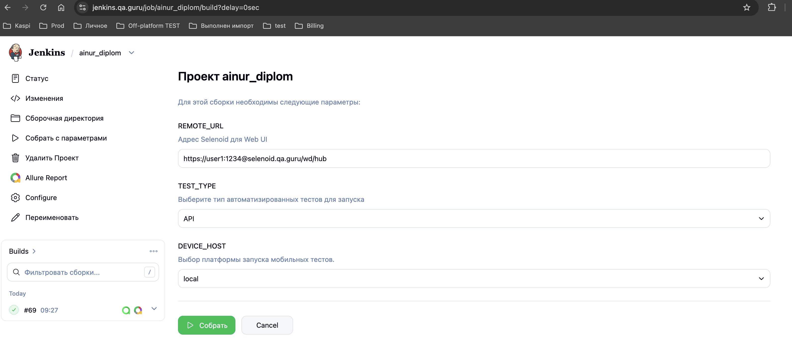
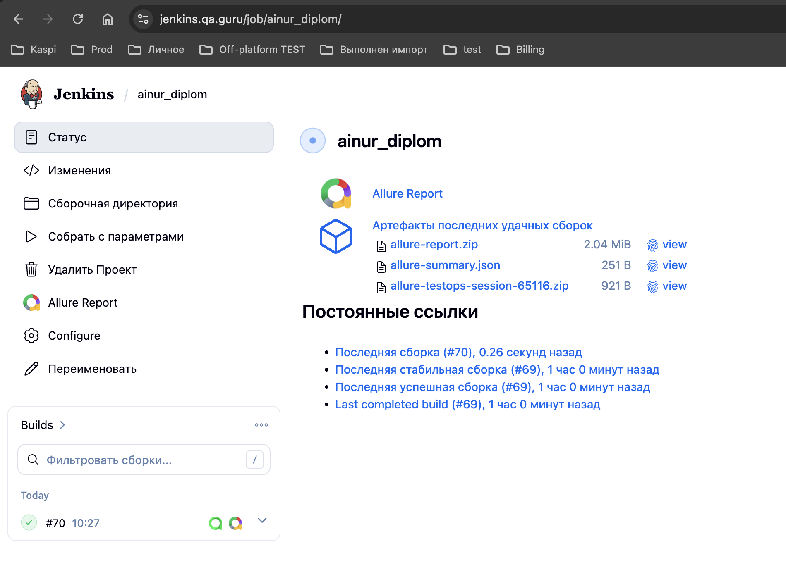
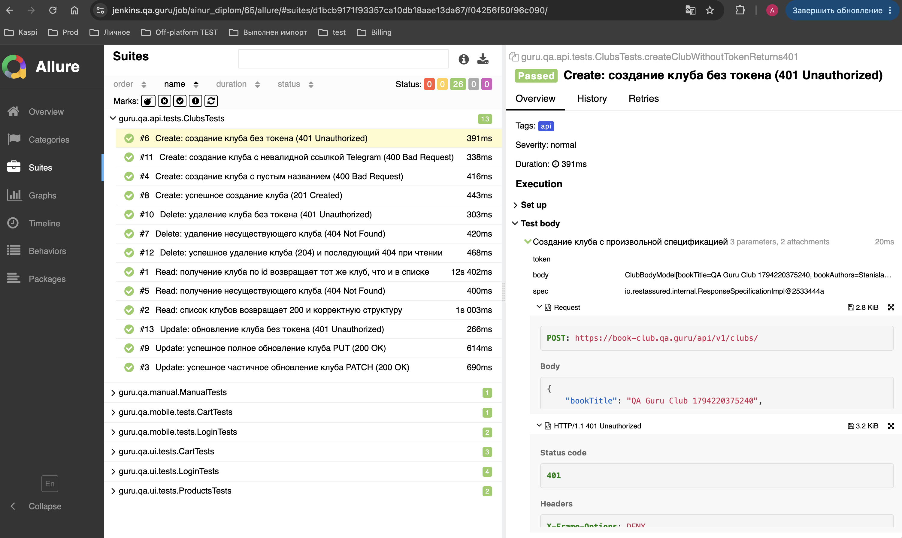
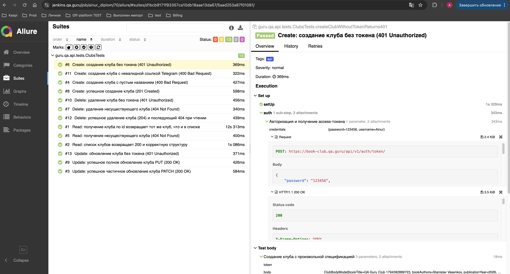
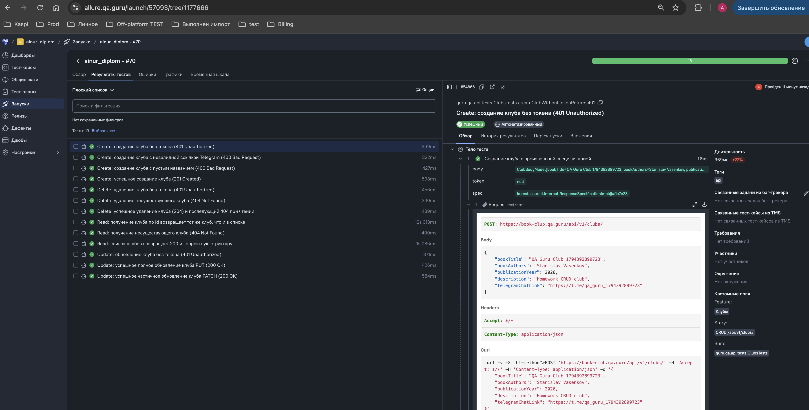
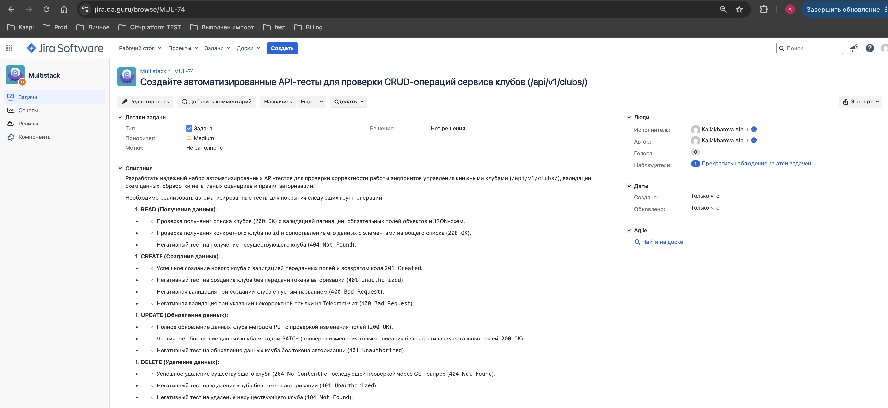
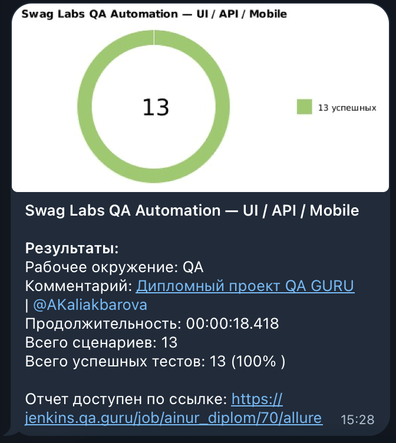

<a id="readme-top"></a>

# 🔌 API Automation Tests — Clubs Service

> Автоматизированное API-тестирование сервиса управления клубами (`/api/v1/clubs/`) на базе Java, RestAssured, JUnit 5 и Allure.

---

## 📜 Содержание:

- <a href="#tools">Технологии и инструменты</a>
- <a href="#structure">Архитектура и структура проекта</a>
- <a href="#cases">Реализованные тест-кейсы</a>
- <a href="#console">Запуск тестов из терминала</a>
- <a href="#jenkins">Запуск тестов через Jenkins</a>
- <a href="#allure">Allure-отчёт</a>
- <a href="#testops">Allure TestOps</a>
- <a href="#jira">Интеграция с Jira</a>
- <a href="#telegram">Telegram-уведомления</a>

---

<a id="tools"></a>
## 🛠 Технологии и инструменты

<p align="center">
  <code>☕ Java 17</code> &nbsp;•&nbsp;
  <code>💻 IntelliJ IDEA</code> &nbsp;•&nbsp;
  <code>🧪 JUnit 5</code> &nbsp;•&nbsp;
  <code>📦 Gradle</code> &nbsp;•&nbsp;
  <code>🌐 RestAssured</code> &nbsp;•&nbsp;
  <code>📋 JSON Schema Validator</code> &nbsp;•&nbsp;
  <code>📊 Allure</code> &nbsp;•&nbsp;
  <code>⚙️ Jenkins</code>
</p>

- **Java 17** — язык реализации автотестов.
- **RestAssured** — библиотека для отправки HTTP-запросов и валидации ответов.
- **JSON Schema Validator** — проверка соответствия структуры JSON-ответов эталонным схемам.
- **JUnit 5** — фреймворк модульного тестирования (`@Tag("api")`).
- **Allure Framework** — формирование детальных отчётов о прогонах.

<p align="right"><a href="#readme-top">⬆️ наверх</a></p>

---

<a id="structure"></a>
## 📂 Архитектура и структура проекта

Пакет автоматизации API-тестов (`src/test/java/guru/qa/api/`) организован по принципам модульности и разделения ответственности:

```text
swag-labs-qa-automation/
├── docs/
│   └── api/
│       └── README.md        # Документация по API-тестам (содержит скриншоты отчетов)
└── src/
    └── test/
        └── java/
            └── guru/
                └── qa/
                    └── api/
                        ├── api/
                        │   ├── ApiClient.java         # Базовый клиент
                        │   ├── AuthApiClient.java     # Клиент авторизации
                        │   └── ClubsApiClient.java    # Клиент эндпоинтов клубов
                        ├── config/
                        │   └── ApiConfig.java         # Конфигурация API
                        ├── models.clubs/
                        │   ├── ClubBodyModel.java     # Модель тела запроса клуба
                        │   ├── ClubModel.java         # Модель объекта клуба
                        │   ├── ClubPatchBodyModel.java# Модель частичного обновления
                        │   ├── ClubReviewModel.java   # Модель отзывов
                        │   ├── ClubReviewUserModel.java# Модель пользователя отзыва
                        │   └── ClubsListResponseModel.java # Модель списка клубов
                        ├── specs/
                        │   └── clubs/
                        │       └── ClubsSpec.java     # Спецификации запросов и ответов
                        ├── BaseSpec.java              # Базовые спецификации
                        ├── TestBase.java              # Базовый класс тестов
                        └── TestData.java              # Тестовые данные
```
<a id="cases"></a>
## ✅ Реализованные тест-кейсы

> В рамках проекта реализовано **13 автоматизированных API-тестов**, проверяющих основные CRUD-операции, валидацию и сценарии безопасности для сервиса управления клубами (`/api/v1/clubs/`).

### 📖 1. READ — Получение данных
* `getClubsListTest` — Получение списка клубов (**Ожидаемый результат:** `200 OK`, корректная структура ответа и схемы).
* `getClubByIdTest` — Получение клуба по ID (**Ожидаемый результат:** `200 OK`, корректные данные объекта).
* `getNonExistentClubTest` — Попытка получения несуществующего клуба (**Ожидаемый результат:** `404 Not Found`).

### ➕ 2. CREATE — Создание данных
* `successfulCreateClubTest` — Успешное создание нового клуба (**Ожидаемый результат:** `201 Created`).
* `createClubWithoutTokenTest` — Попытка создания клуба без access token (**Ожидаемый результат:** `401 Unauthorized`).
* `createClubWithEmptyNameTest` — Создание клуба с пустым обязательным названием (**Ожидаемый результат:** `400 Bad Request`).
* `createClubWithInvalidTelegramTest` — Создание клуба с некорректным форматом ссылки Telegram (**Ожидаемый результат:** `400 Bad Request`).

### ✏️ 3. UPDATE — Обновление данных
* `fullUpdateClubPutTest` — Полное обновление данных клуба методом `PUT` (**Ожидаемый результат:** `200 OK`).
* `partialUpdateClubPatchTest` — Частичное обновление данных клуба методом `PATCH` (**Ожидаемый результат:** `200 OK`).
* `updateClubWithoutTokenTest` — Попытка обновления данных без access token (**Ожидаемый результат:** `401 Unauthorized`).

### 🗑️ 4. DELETE — Удаление данных
* `successfulDeleteClubTest` — Успешное удаление существующего клуба (**Ожидаемый результат:** `204 No Content`).
* `deleteClubWithoutTokenTest` — Попытка удаления клуба без access token (**Ожидаемый результат:** `401 Unauthorized`).
* `deleteNonExistentClubTest` — Попытка удаления несуществующего клуба (**Ожидаемый результат:** `404 Not Found`).

<p align="right"><a href="#readme-top">⬆️ наверх</a></p>


<a id="console"></a>
## 💻 Запуск тестов из терминала

Локальный запуск API-тестов:
```
./gradlew clean test -DtestTags=api
```
Запуск с генерацией Allure-отчёта:
```
./gradlew clean test -DtestTags=api allureServe
```
## ⚙️ Запуск тестов через Jenkins

Для запуска API-тестов в CI/CD используется проект в Jenkins: [ainur_diplom](https://jenkins.qa.guru/job/ainur_diplom/)

### Параметры сборки:
Для запуска выбирается параметр TEST_TYPE = API:

<p align="center">
  
</p>

### Результаты прогона в Jenkins
После завершения сборки (#70) все тесты успешно отработали

<p align="center">
  
</p>

---

<a id="allure"></a>

<a id="allure"></a>
## 📊  [Allure-отчет](https://jenkins.qa.guru/job/ainur_diplom/69/allure/)
### Основная страница отчета
<p align="center">
  
</p>

### Тест-кейсы
<p align="center">
  
</p>

---
<a id="testops"></a>
## 📊 Просмотр результатов в Allure TestOps

Результаты выполнения тестов автоматически выгружаются в Allure TestOps. Посмотреть детальный отчет и шаги прогона можно по [ссылке на лаунч в Allure TestOps](https://allure.qa.guru/launch/57093/tree/1177666)

<p align="center">
  
</p>

<p align="right"><a href="#readme-top">⬆️ наверх</a></p>

---
<a id="jira"></a>
## 🔗 Интеграция с Jira

В рамках проекта настроена интеграция с Jira. Задача на автоматизацию интерфейса **[MUL-74](https://jira.qa.guru/browse/MUL-74)**

<p align="center">
  
</p>

<p align="right"><a href="#readme-top">⬆️ наверх</a></p>

---

<a id="telegram"></a>
## 📱 Telegram-уведомления о прогоне

В процессе выполнения сборки в Jenkins настроена автоматическая отправка нотификаций в Telegram-чат с общей статистикой успешных тестов (13 из 13 успешных, 100%):

<p align="center">
  
</p>

<p align="right"><a href="#readme-top">⬆️ наверх</a></p>

---
<p align="center">
  <a href="../../README.md"><b>👈 Вернуться на главную страницу репозитория</b></a>
</p>