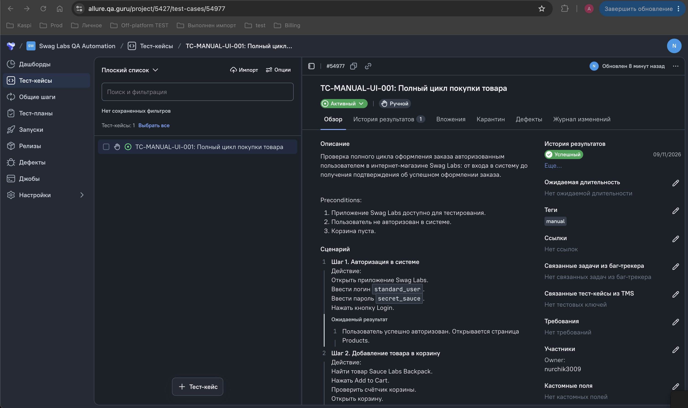
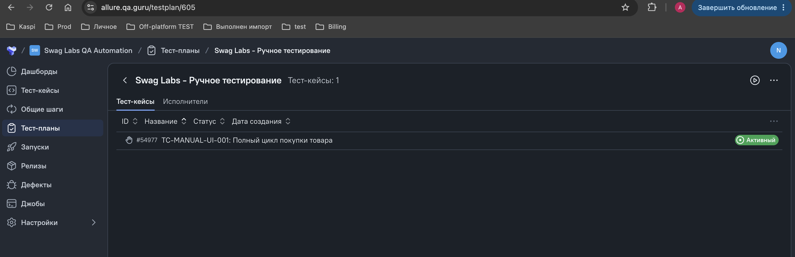
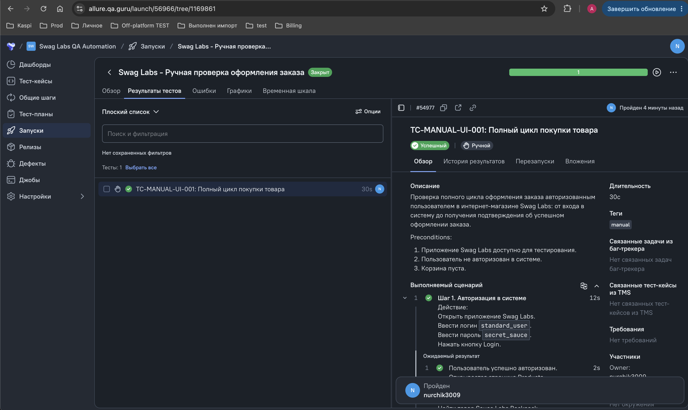
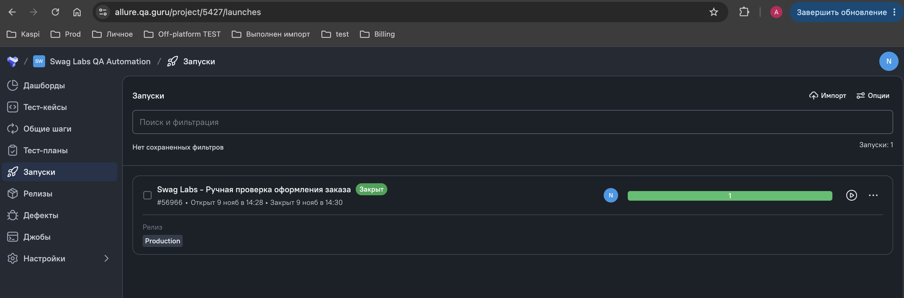
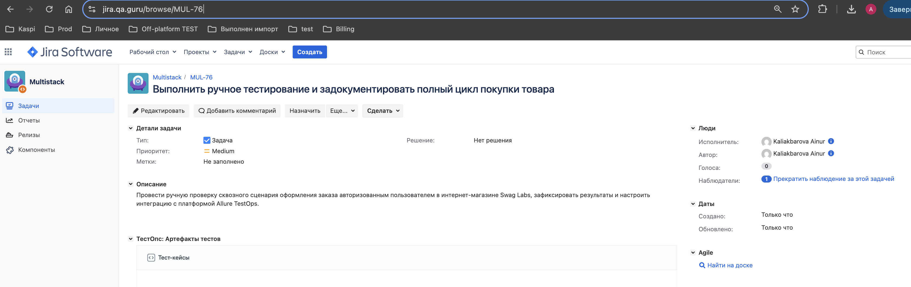

<a id="readme-top"></a>

# 📝 Manual Testing — Swag Labs

> Ручное тестирование и управление тестовой документацией интернет-магазина [Swag Labs](https://www.saucedemo.com/) с использованием Allure TestOps.

---

## 📜 Содержание:

- <a href="#tools">Инструменты и подход</a>
- <a href="#structure">Архитектура и структура проекта</a>
- <a href="#cases">Реализованный ручной тест-кейс</a>
- <a href="#console">Запуск ручных тестов из терминала</a>
- <a href="#testops">Результаты в Allure TestOps</a>
- <a href="#jira">Интеграция с Jira</a>

---

<a id="tools"></a>
## 🛠 Инструменты и подход

<p align="center">
  <code>☕ Java 17</code> &nbsp;•&nbsp;
  <code>💻 IntelliJ IDEA</code> &nbsp;•&nbsp;
  <code>🧪 JUnit 5</code> &nbsp;•&nbsp;
  <code>📦 Gradle</code> &nbsp;•&nbsp;
  <code>📊 Allure TestOps</code> &nbsp;•&nbsp;
  <code>🌐 Swag Labs</code>
</p>

- **Allure TestOps** — платформа управления тестированием, планирования тест-ранов и фиксации результатов ручных проверок.
- **JUnit 5 & Allure Steps** — программное описание тест-кейса в коде (`@Tag("manual")`) для интеграции с отчётностью.
- **Swag Labs** — тестируемое веб-приложение.

<p align="right"><a href="#readme-top">⬆️ наверх</a></p>

---

<a id="structure"></a>
## 📂 Архитектура и структура проекта

Пакет ручного тестирования (`src/test/java/guru/qa/manual/`) содержит описания сценариев для синхронизации с TestOps:

```text
swag-labs-qa-automation/
├── docs/
│   └── manual/
│       └── README.md                # Документация по ручному тестированию
└── src/
    └── test/
        └── java/
            └── guru/
                └── qa/
                    └── manual/
                        └── ManualTests.java # Описание ручного тест-кейса
```
---

<a id="structure"></a>
## ✅ Реализованный ручной тест-кейс
В рамках дипломного проекта задокументирован и выполнен ключевой сквозной сценарий покупки товара.

🛒 **TC-MANUAL-UI-001: Полный цикл покупки товара (Checkout Flow)**
Тип тестирования: Manual

Направление: UI

Приоритет: BLOCKER

Статус: Passed

---

💻 Запуск ручных тестов из терминала
Запуск ручных тест-кейсов:
```
./gradlew clean test -DtestTags=manual
```
Генерация Allure-отчёта:

```
./gradlew allureServe
```

---


<a id="testops"></a>
## 📊 Просмотр результатов в Allure TestOps

Результаты выполнения тестов автоматически выгружаются в Allure TestOps. Посмотреть детальный отчет и шаги прогона можно по [ссылке на лаунч в Allure TestOps](https://allure.qa.guru/project/5427/test-cases/54977)

1. Карточка тест-кейса в Allure TestOps
<p align="center">
  
</p>

2. План тестирования (Test Plan)
<p align="center">
  
</p>

3. Процесс выполнения шагов
<p align="center">
  
</p>

4. Итоговый Launch (Passed)
<p align="center">
  
</p>

<p align="right"><a href="#readme-top">⬆️ наверх</a></p>

---
<a id="jira"></a>
## 🔗 Интеграция с Jira

В рамках проекта настроена интеграция с Jira. Задача на проведение ручного тестирования и документацию: **[MUL-76](https://jira.qa.guru/browse/MUL-76)**

<p align="center">
  
</p>

<p align="right"><a href="#readme-top">⬆️ наверх</a></p>

---
<p align="center">
  <a href="../../README.md"><b>👈 Вернуться на главную страницу репозитория</b></a>
</p>