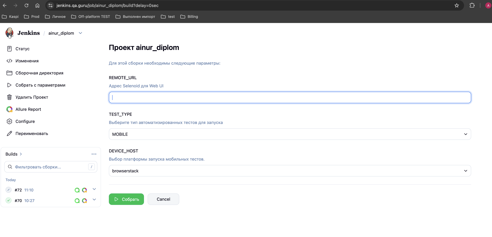
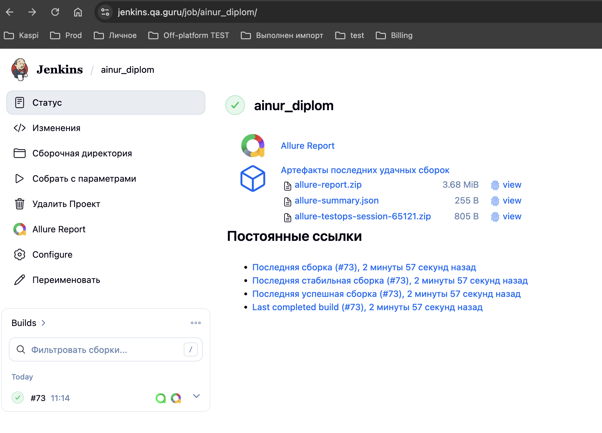
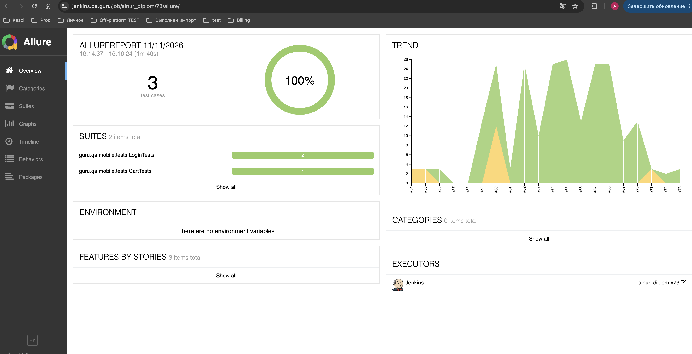
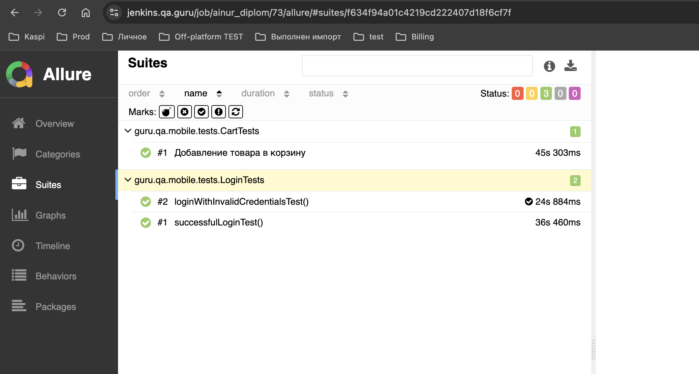
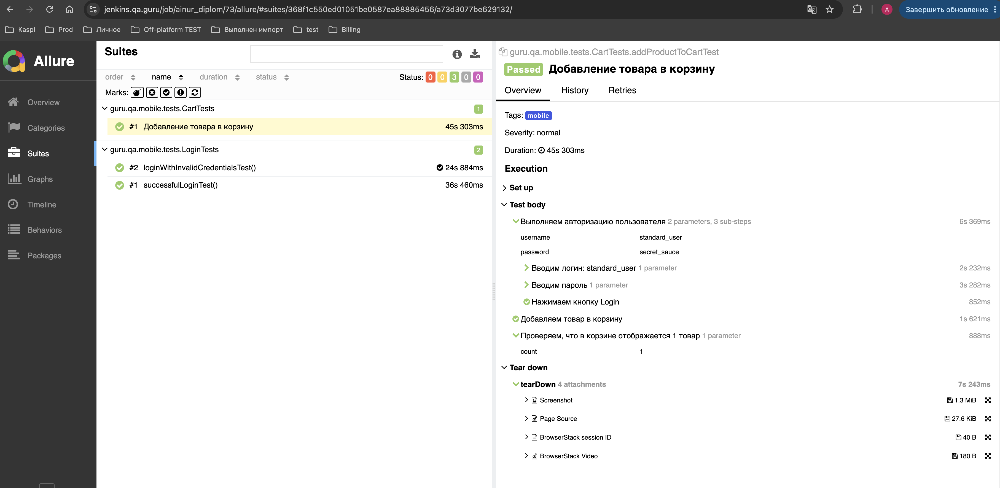
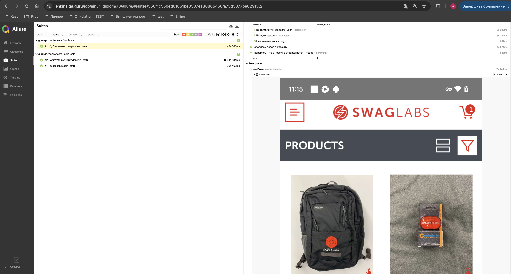
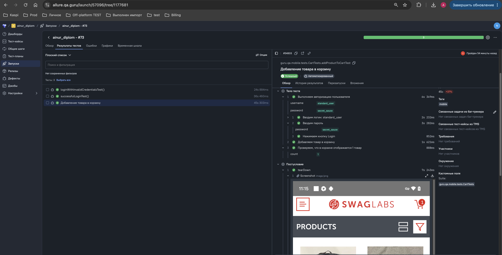
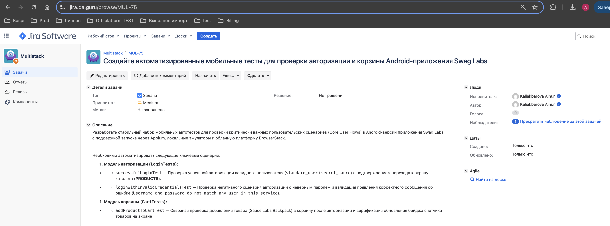
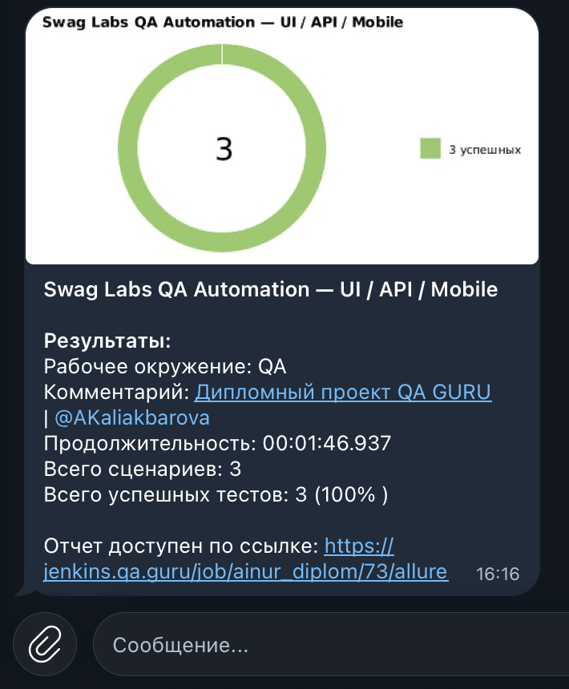

<a id="readme-top"></a>

# 📱 Mobile Automation Tests — Swag Labs

> Автоматизированное мобильное тестирование Android-приложения [Swag Labs](https://www.saucedemo.com/) на базе Java, Appium, Selenide-Appium, JUnit 5 и BrowserStack.

---

## 📜 Содержание:

- <a href="#tools">Технологии и инструменты</a>
- <a href="#structure">Архитектура и структура проекта</a>
- <a href="#cases">Реализованные тест-кейсы</a>
- <a href="#console">Запуск тестов из терминала</a>
- <a href="#jenkins">Запуск тестов через Jenkins</a>
- <a href="#allure">Allure-отчёт и вложения</a>
- <a href="#video">Видео прохождения тестов</a>
- <a href="#testops">Allure TestOps</a>
- <a href="#jira">Интеграция с Jira</a>
- <a href="#telegram">Telegram-уведомления</a>

---

<a id="tools"></a>
## 🛠 Технологии и инструменты

<p align="center">
  <code>☕ Java 17</code> &nbsp;•&nbsp;
  <code>💻 IntelliJ IDEA</code> &nbsp;•&nbsp;
  <code>🧪 JUnit 5</code> &nbsp;•&nbsp;
  <code>📦 Gradle</code> &nbsp;•&nbsp;
  <code>📱 Appium</code> &nbsp;•&nbsp;
  <code>☁️ BrowserStack</code> &nbsp;•&nbsp;
  <code>📊 Allure</code> &nbsp;•&nbsp;
  <code>⚙️ Jenkins</code>
</p>

- **Java 17** — язык написания автотестов.
- **Appium & Selenide-Appium** — фреймворки для автоматизации мобильных приложений.
- **BrowserStack** — облачная платформа для реального запуска мобильных устройств.
- **JUnit 5** — тестовый фреймворк (`@Tag("mobile")`).
- **Allure Framework** — детальные отчёты с шагами и вложениями.

<p align="right"><a href="#readme-top">⬆️ наверх</a></p>

---

<a id="structure"></a>
## 📂 Архитектура и структура проекта

Мобильный модуль тестов (`src/test/java/guru/qa/mobile/`) построен с использованием Page Object Pattern и разделением конфигураций:

```text
swag-labs-qa-automation/
├── docs/
│   └── mobile/
│       └── README.md        # Документация по мобильным тестам (с сопутствующими скриншотами)
└── src/
    └── test/
        └── java/
            └── guru/
                └── qa/
                    └── mobile/
                        ├── config/
                        │   ├── BrowserstackConfig.java # Конфиг BrowserStack
                        │   ├── LocalConfig.java        # Локальный конфиг
                        │   └── MobileConfig.java       # Общий конфиг мобилок
                        ├── drivers/
                        │   ├── BrowserstackMobileDriver.java # Драйвер для облака
                        │   └── LocalMobileDriver.java        # Драйвер для эмулятора
                        ├── helpers/
                        │   ├── AndroidHelpers.helpers        # Помощники Android
                        │   └── Attach.java                   # Вложения Allure
                        ├── pages/
                        │   ├── LoginPage.java          # Страница авторизации
                        │   └── ProductsPage.java       # Каталог товаров
                        ├── tests/
                        │   ├── CartTests.java          # Тесты корзины
                        │   └── LoginTests.java         # Тесты авторизации
                        └── BaseTest.java               # Базовый класс мобильных тестов
```
---
<a id="cases"></a>
## ✅ Реализованные тест-кейсы

> В рамках проекта реализованы автоматизированные мобильные тесты для ключевых сценариев приложения:

### 🔐 Авторизация (`LoginTests`)
* `successfulLoginTest` — Успешная авторизация стандартного пользователя (`standard_user`) с проверкой отображения экрана каталога (**PRODUCTS**).
* `loginWithInvalidCredentialsTest` — Проверка появления сообщения об ошибке (`Username and password do not match any user in this service`) при вводе неверного пароля.

### 🛒 Корзина (`CartTests`)
* `addProductToCartTest` — Добавление товара (Sauce Labs Backpack) в корзину и проверка обновления бейджа счётчика товаров (`1`).

<p align="right"><a href="#readme-top">⬆️ наверх</a></p>

---

<a id="cases"></a>
## 💻 Запуск тестов из терминала
Локальный запуск мобильных тестов:
```
./gradlew clean test -DtestTags=mobile
```
Запуск с генерацией Allure-отчёта:
```
./gradlew clean test -DtestTags=mobile allureServe
```
---
<a id="jenkins"></a>
## ⚙️ Запуск тестов через Jenkins

Для запуска Mobile-тестов в CI/CD используется проект в Jenkins: [ainur_diplom](https://jenkins.qa.guru/job/ainur_diplom/)

### Параметры сборки:
Для запуска выбирается параметр TEST_TYPE = API, DEVICE_HOST = browserstack, REMOTE_URL = оставить пустым


<p align="center">
  
</p>

### Результаты прогона в Jenkins
После завершения сборки (#73) все тесты успешно отработали

<p align="center">
  
</p>

---

<a id="allure"></a>

<a id="allure"></a>
##  [Allure-отчет](https://jenkins.qa.guru/job/ainur_diplom/69/allure/)
### Основная страница отчета
<p align="center">
  
</p>

### Тест-кейсы
<p align="center">
  
</p>

### Шаги выполнения
<p align="center">
  
</p>

### Автоматические вложения
К каждому тесту прикрепляются: скриншот, page Source, логи консоли и видео.
<p align="center">
  
</p>

<p align="right"><a href="#readme-top">⬆️ наверх</a></p>

---
<a id="video"></a>
## 🎥Видео прохождения тестов в Selenoid

<p align="center">
  
</p>

<p align="right"><a href="#readme-top">⬆️ наверх</a></p>

---

<a id="testops"></a>
## 📊 Просмотр результатов в Allure TestOps

Результаты выполнения тестов автоматически выгружаются в Allure TestOps. Посмотреть детальный отчет и шаги прогона можно по [ссылке на лаунч в Allure TestOps](https://allure.qa.guru/launch/57096/tree/1177681)

<p align="center">
  
</p>

<p align="right"><a href="#readme-top">⬆️ наверх</a></p>

---
<a id="jira"></a>
## 🔗 Интеграция с Jira

В рамках проекта настроена интеграция с Jira. Задача на автоматизацию интерфейса **[MUL-75](https://jira.qa.guru/browse/MUL-75)**

<p align="center">
  
</p>

<p align="right"><a href="#readme-top">⬆️ наверх</a></p>

---
<a id="telegram"></a>
## 📱 Telegram-уведомления о прогоне

В процессе выполнения сборки в Jenkins настроена автоматическая отправка нотификаций в Telegram-чат с общей статистикой успешных тестов (3 из 3 успешных, 100%):

<p align="center">
  
</p>

<p align="right"><a href="#readme-top">⬆️ наверх</a></p>

---
<p align="center">
  <a href="../../README.md"><b>👈 Вернуться на главную страницу репозитория</b></a>
</p>